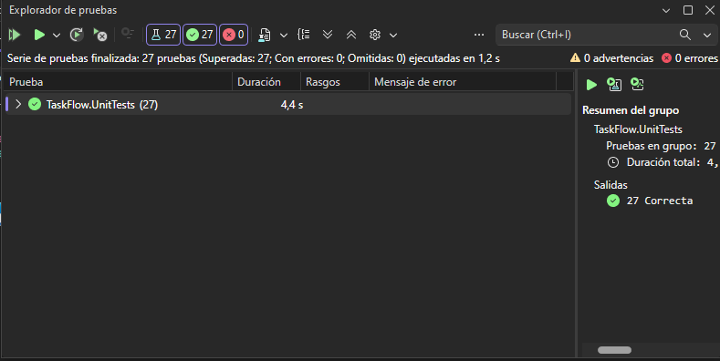
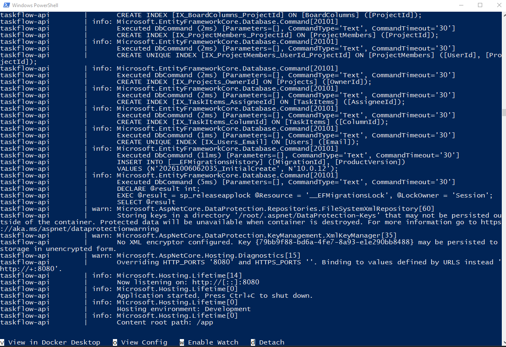
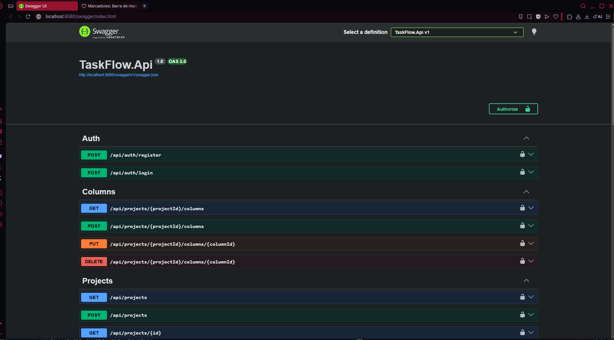
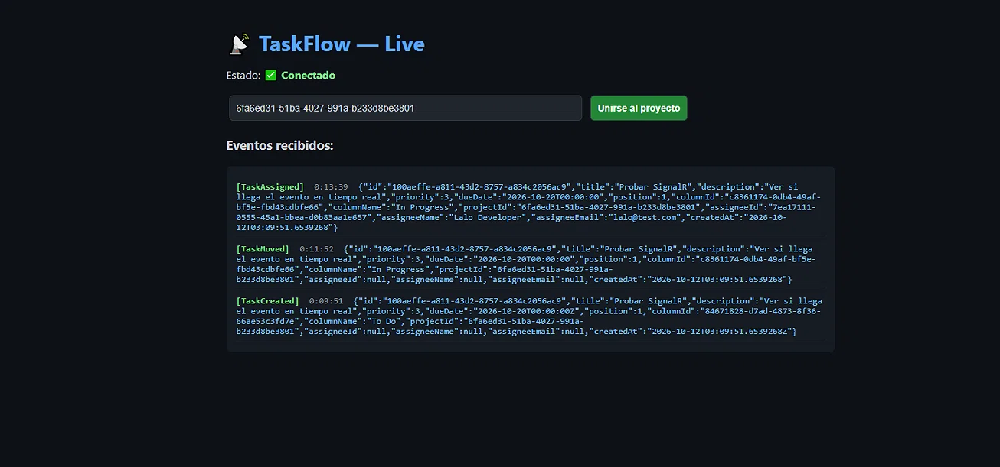

# TaskFlow 🚀

> 🌐 **English** | [Español](README.es.md)

A Trello/Notion-style project and task manager API, built with **.NET 10** using **Clean Architecture**, **CQRS**, **JWT Authentication**, **SignalR** for real-time updates, and fully **Dockerized**.

[](https://dotnet.microsoft.com/)
[](https://www.microsoft.com/sql-server)
[](https://dotnet.microsoft.com/apps/aspnet/signalr)
[](https://www.docker.com/)
[](https://github.com/JacevedoEspindola/taskflow)
[](https://opensource.org/licenses/MIT)

---

## 📋 Table of Contents

- [About the project](#-about-the-project)
- [Tech Stack](#-tech-stack)
- [Architecture](#️-architecture)
- [Features](#-features)
- [Testing](#-testing)
- [Docker](#-docker)
- [Screenshots](#-screenshots)
- [Getting Started](#-getting-started)
- [API Endpoints](#-api-endpoints)
- [Roadmap](#️-roadmap)
- [Author](#-author)

---

## 🎯 About the project

TaskFlow is a REST API that allows managing projects, columns and tasks in a Kanban style (like Trello). The goal of this project is to demonstrate backend best practices with .NET:

- **Clean Architecture** with strict separation of concerns.
- **CQRS** with MediatR for decoupled use cases.
- **FluentValidation** with automatic pipeline.
- **JWT** for stateless authentication.
- **BCrypt** for secure password hashing.
- **SignalR** for real-time notifications.
- **Entity Framework Core** with Fluent API configurations.
- **Role-based permissions** per project (Owner, Admin, Member).
- **Unit tests** with xUnit, Moq and FluentAssertions.
- **Fully Dockerized** with multi-stage builds and docker-compose.

---

## 🛠️ Tech Stack

### Backend
| Technology | Purpose |
|---|---|
| **.NET 10** | Core framework |
| **ASP.NET Core Minimal APIs** | HTTP endpoints |
| **Entity Framework Core 10** | ORM |
| **SQL Server 2022** | Database |
| **MediatR** | CQRS pattern |
| **FluentValidation** | Command validation |
| **JWT** | Authentication |
| **BCrypt.Net-Next** | Password hashing |
| **SignalR** | Real-time (WebSockets) |
| **Swagger / OpenAPI** | API documentation |

### Testing
| Technology | Purpose |
|---|---|
| **xUnit** | Testing framework |
| **Moq** | Dependency mocking |
| **FluentAssertions** | Readable assertions |
| **EF Core InMemory** | In-memory database for tests |
| **Coverlet** | Code coverage |

### DevOps
| Technology | Purpose |
|---|---|
| **Docker** | Containerization |
| **Docker Compose** | Multi-container orchestration |

### Coming Soon
- **React + TypeScript** (frontend)
- **GitHub Actions** (CI/CD)
- **Cloud deploy** (Azure / Railway)

---

## 🏛️ Architecture

The project follows **Clean Architecture**, with dependencies always pointing inward:

```
┌─────────────────────────────────────────┐
│              TaskFlow.Api               │  ← Endpoints, DI, Middleware, Hubs
├─────────────────────────────────────────┤
│         TaskFlow.Infrastructure         │  ← EF Core, JWT, BCrypt, SignalR
├─────────────────────────────────────────┤
│          TaskFlow.Application           │  ← Use cases, MediatR, DTOs
├─────────────────────────────────────────┤
│             TaskFlow.Domain             │  ← Entities, business rules
└─────────────────────────────────────────┘
```

### Folder structure

```
TaskFlow/
├── TaskFlow.Domain/
│   └── Entities/                → User, Project, ProjectMember, BoardColumn, TaskItem
│
├── TaskFlow.Application/
│   ├── Common/
│   │   ├── Behaviors/           → ValidationBehavior (FluentValidation)
│   │   └── Interfaces/          → IApplicationDbContext, IJwtService,
│   │                              IPasswordHasher, ICurrentUserService, IRealTimeNotifier
│   └── Features/
│       ├── Auth/                → Register + Login
│       ├── Projects/            → Project CRUD
│       ├── Columns/             → Column CRUD
│       └── Tasks/               → Task CRUD + Move + Assign
│
├── TaskFlow.Infrastructure/
│   ├── Authentication/          → JwtService, PasswordHasher, JwtSettings
│   ├── Persistence/             → ApplicationDbContext + Configurations
│   ├── RealTime/                → NotificationHub, SignalRNotifier
│   └── Services/                → CurrentUserService
│
├── TaskFlow.Api/
│   ├── Endpoints/               → Auth, Projects, Columns, Tasks
│   ├── Middleware/              → ExceptionHandlingMiddleware
│   └── wwwroot/                 → live.html (SignalR test client)
│
└── tests/
    └── TaskFlow.UnitTests/      → xUnit tests (27 tests)
```

---

## ✅ Features

### Authentication
- [x] User registration with validation
- [x] Login with JWT generation
- [x] BCrypt password hashing
- [x] Automatic FluentValidation pipeline
- [x] Global exception handling with structured JSON responses

### Projects
- [x] Full CRUD for projects
- [x] Role-based authorization (Owner, Admin, Member)
- [x] Default columns (To Do, In Progress, Done) on creation
- [x] Only project members can view/edit

### Columns
- [x] Full CRUD for columns
- [x] Positioning and reordering
- [x] Only Owners/Admins can modify

### Tasks
- [x] Full CRUD for tasks
- [x] Priorities (Low, Medium, High, Critical)
- [x] Optional due date
- [x] **Move tasks between columns** (backend drag & drop)
- [x] **Assign tasks to project members**
- [x] Positioning within columns

### Real-time (SignalR)
- [x] Notifications on task create/move/assign
- [x] Project-based groups (only members receive events)
- [x] JWT authentication on the hub
- [x] HTML test client (`/live.html`)

---

## 🧪 Testing

The project includes **27 unit tests** with xUnit, Moq and FluentAssertions, covering the critical business logic.

### Run tests

```bash
dotnet test
```

### Test coverage

| Module | Tests |
|---|---|
| **Auth** | Register/Login validators, `RegisterCommandHandler`, `LoginCommandHandler` |
| **Projects** | `CreateProjectCommandHandler` (creation + validations) |
| **Columns** | `CreateColumnCommandHandler` (automatic position + permissions) |
| **Tasks** | `MoveTaskCommandHandler` (reordering, SignalR notifications, validations) |

### Example test

```csharp
[Fact]
public async Task Should_Move_Task_To_Target_Column_When_Target_Is_Different()
{
    // Arrange
    var (db, _, _, inProgressColumnId, taskId) = await SeedScenarioAsync();
    var handler = new MoveTaskCommandHandler(db, _currentUserMock.Object, _notifierMock.Object);
    var command = new MoveTaskCommand(taskId, inProgressColumnId, Position: null);

    // Act
    var result = await handler.Handle(command, CancellationToken.None);

    // Assert
    result.ColumnId.Should().Be(inProgressColumnId);
    result.ColumnName.Should().Be("In Progress");

    var task = await db.TaskItems.FindAsync(taskId);
    task!.Position.Should().Be(1);
}
```

### Test results



---

## 🐳 Docker

The project includes a **multi-stage Dockerfile** and **docker-compose** to run the entire stack (API + SQL Server) with a single command.

### Run everything

```bash
docker-compose up --build
```

The API will be available at `http://localhost:8080/swagger`.

### What's included

- **Multi-stage Dockerfile** → final image ~200 MB (vs ~1 GB with SDK).
- **SQL Server 2022** in a container with health check.
- **Auto-migration** on startup (Development only).
- **Persistent volume** for SQL Server data.

### Docker Compose up



### Swagger running in Docker



---

## 📸 Screenshots

### Swagger UI


### Authentication

**Register success:**


**Login success:**


**Users in database (with hashed password):**


### Projects CRUD

**Create project (with auto-generated columns):**


**List projects:**


**Project detail:**


### Real-time (SignalR)

**Live events when tasks are created/moved/assigned:**


### Project structure


---

## 🚀 Getting Started

### Prerequisites
- [.NET 10 SDK](https://dotnet.microsoft.com/download/dotnet/10.0)
- [SQL Server Express or higher](https://www.microsoft.com/sql-server/sql-server-downloads) *(or use Docker)*
- [SQL Server Management Studio (SSMS)](https://aka.ms/ssmsfullsetup) *(optional)*
- [Docker Desktop](https://www.docker.com/products/docker-desktop/) *(optional, recommended)*

### Option 1: Run with Docker (recommended)

```bash
git clone https://github.com/JacevedoEspindola/taskflow.git
cd taskflow
docker-compose up --build
```

Open `http://localhost:8080/swagger`.

### Option 2: Run locally

1. **Clone the repository:**
   ```bash
   git clone https://github.com/JacevedoEspindola/taskflow.git
   cd taskflow
   ```

2. **Configure the connection string** in `TaskFlow.Api/appsettings.json`:
   ```json
   "ConnectionStrings": {
     "DefaultConnection": "Server=localhost\\SQLEXPRESS;Database=TaskFlowDb;Trusted_Connection=True;TrustServerCertificate=True;MultipleActiveResultSets=true"
   }
   ```

3. **Configure the JWT secret** in `TaskFlow.Api/appsettings.json`:
   ```json
   "Jwt": {
     "Secret": "TaskFlow-Super-Secret-Key-For-Development-Only-Min-32-Chars-Long!!",
     "Issuer": "TaskFlowAPI",
     "Audience": "TaskFlowClient",
     "ExpirationMinutes": 60
   }
   ```

4. **Apply migrations:**
   ```bash
   dotnet ef database update -p TaskFlow.Infrastructure -s TaskFlow.Api
   ```

5. **Run the API:**
   ```bash
   dotnet run --project TaskFlow.Api
   ```

6. **Open Swagger:**
   ```
   https://localhost:7236/swagger
   ```

---

## 📡 API Endpoints

### Auth
| Method | Route | Description |
|---|---|---|
| `POST` | `/api/auth/register` | Register a new user |
| `POST` | `/api/auth/login` | Login (returns JWT) |

### Projects
| Method | Route | Description |
|---|---|---|
| `GET` | `/api/projects` | List my projects |
| `POST` | `/api/projects` | Create project |
| `GET` | `/api/projects/{id}` | Get project details |
| `PUT` | `/api/projects/{id}` | Update (Owner/Admin) |
| `DELETE` | `/api/projects/{id}` | Delete (Owner/Admin) |

### Columns
| Method | Route | Description |
|---|---|---|
| `GET` | `/api/projects/{projectId}/columns` | List columns |
| `POST` | `/api/projects/{projectId}/columns` | Create column |
| `PUT` | `/api/projects/{projectId}/columns/{id}` | Update / Reorder |
| `DELETE` | `/api/projects/{projectId}/columns/{id}` | Delete |

### Tasks
| Method | Route | Description |
|---|---|---|
| `GET` | `/api/columns/{columnId}/tasks` | Tasks in a column |
| `POST` | `/api/columns/{columnId}/tasks` | Create task |
| `GET` | `/api/tasks/{id}` | Task details |
| `PUT` | `/api/tasks/{id}` | Update task |
| `PATCH` | `/api/tasks/{id}/move` | **Move between columns** |
| `PATCH` | `/api/tasks/{id}/assign` | **Assign user** |
| `DELETE` | `/api/tasks/{id}` | Delete task |

### SignalR
| Route | Description |
|---|---|
| `/hubs/notifications` | Real-time hub (requires JWT) |

**Events emitted:**
- `TaskCreated` — when a task is created
- `TaskMoved` — when a task is moved between columns
- `TaskAssigned` — when the assignee changes

### Quick authentication test

**Register:**
```http
POST /api/auth/register
Content-Type: application/json

{
  "email": "user@test.com",
  "password": "Password123",
  "fullName": "Test User"
}
```

**Login:**
```http
POST /api/auth/login
Content-Type: application/json

{
  "email": "user@test.com",
  "password": "Password123"
}
```

---

## 🗺️ Roadmap

- [x] **Phase 1:** Setup + Clean Architecture
- [x] **Phase 2:** Authentication (Register + Login + JWT)
- [x] **Phase 3:** Projects CRUD + Roles + Authorization
- [x] **Phase 4:** Columns CRUD
- [x] **Phase 5:** Tasks CRUD + Move + Assign
- [x] **Phase 6:** SignalR (real-time)
- [x] **Phase 7:** Unit tests with xUnit + Moq
- [x] **Phase 8:** Docker + Docker Compose
- [ ] **Phase 9:** CI/CD with GitHub Actions
- [ ] **Phase 10:** Cloud deploy (Azure / Railway)
- [ ] **Phase 11:** Frontend with React + TypeScript

---

## 👤 Author

**Lalo Acevedo**
- GitHub: [@JacevedoEspindola](https://github.com/JacevedoEspindola)

---

## 📄 License

This project is licensed under the MIT License. See the [`LICENSE`](LICENSE) file for details.